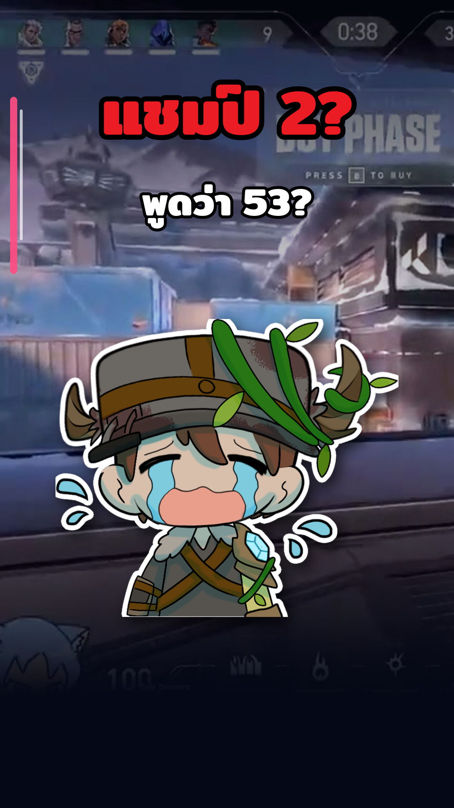

# Armigon Shorts — approved portrait style

ผู้ใช้เลือกงานแนวตั้งจากรอบวันที่ 2026-10-13 ให้เป็นตัวอย่างสำหรับปก Shorts ของ Armigon ในรอบต่อไป

ตัวอย่างนี้คัดจากปก Timeline #065 ใน `outputs/armigon/2026-10-13/` เพื่อยึดองค์ประกอบภาพ ไม่ใช่ยึดข้อความหรือฉากเดิม

## แนวทางที่ให้คงไว้

- ขนาด 1080 × 1920 แนวตั้ง จัดองค์ประกอบใหม่จากเฟรมเกมของ Timeline นั้น
- ใช้ฟุตเทจเกมเต็มเฟรมและคงรายละเอียดเกมที่มองเห็นได้ ลดความสว่างหรือใส่ gradient เท่าที่จำเป็นต่อการอ่าน
- วาง hook ไทยสั้น สีแดง ขอบดำ หนาและกึ่งกลางบริเวณด้านบน; วางข้อความรองสีขาวขอบดำถัดลงมา
- วางแถบ accent แนวตั้งเส้นบางทางซ้าย เลือกสีให้เข้ากับฉาก
- ใช้ Armigon ขนาดใหญ่ช่วงกลางถึงล่าง พร้อมขอบสติกเกอร์สีขาวและเงา ให้สีหน้า/ท่าทางสอดคล้องกับคลิป
- ตรวจให้อ่านได้เมื่อย่อเป็น 180 × 320 และหลบพื้นที่ UI ด้านขวากับ 25% ล่างของ Shorts

## ปรับตามแต่ละ Timeline

คงภาษาภาพและลำดับสายตาตามตัวอย่าง แต่เลือกเฟรมเกม hook ข้อความรอง pose และสี accent ใหม่ให้ตรงเหตุการณ์ของแต่ละ Timeline อย่าคัดลอกคำว่า “แชมป์ 2?” หรือ “พูดว่า 53?” ไปยังคลิปอื่น
